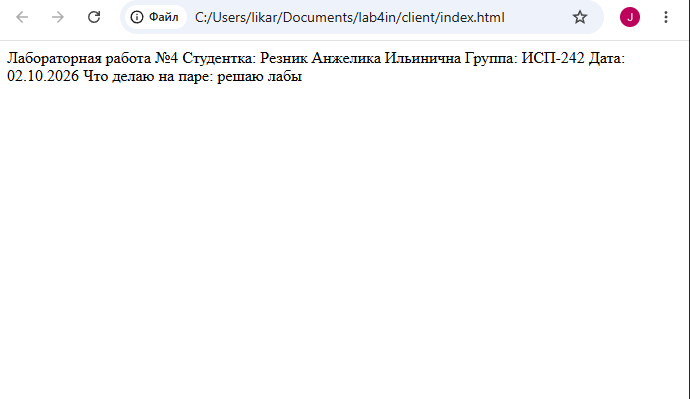

# лабораторная работа №4. примеры разметки markdown

## разработчик: резник анжелика ильинична
### группа: исп-242
#### дата: 04.11.2026

## 1. заголовки всех уровней
# заголовок h1
## заголовок h2
### заголовок h3
#### заголовок h4
##### заголовок h5
###### заголовок h6

---

## 2. форматирование текста
* **это жирный текст** для важных слов
* *это курсивный текст* для обычного выделения
* ~~это зачеркнутый текст~~ если что-то поменялось
* `git status` — моноширинный код внутри строки

---

## 3. списки
### маркированный список:
* изучить основы html
* написать бэкенд на c#
* разобраться с терминалом

### нумерованный и вложенный список:
1. запустить git bash
2. ввести команды для работы с файлами
    - `mkdir` для создания папок
    - `touch` для создания файлов
3. сделать коммит

---

## 4. цитаты
> это пример обычной цитаты в markdown для выделения мыслей.
>> а это вложенная цитата для подпунктов.

---

## 5. блоки кода
пример вывода статуса репозитория:
`git status`
---

## 6. таблица

| функция | команда git | описание |
| :--- | :---: | ---: |
| статус | `git status` | проверка измененных файлов |
| коммит | `git commit` | сохранение изменений локально |
| отправка | `git push` | загрузка на сервер |

---

## 7. картинка и ссылки
внешняя ссылка: [руководство по markdown](https://markdownguide.org)

внутренняя ссылка: [перейти к формулам latex](./latex_examples.md)

картинка из папки repo:

---

## 8. чекбоксы
- [x] сделано: создание структуры проекта
- [x] сделано: написание кода фронтенда и бэкенда
- [ ] не сделано: защитить лабораторную работу

---

## 9. alert-блоки github
> [!NOTE]
> лаба на ура!