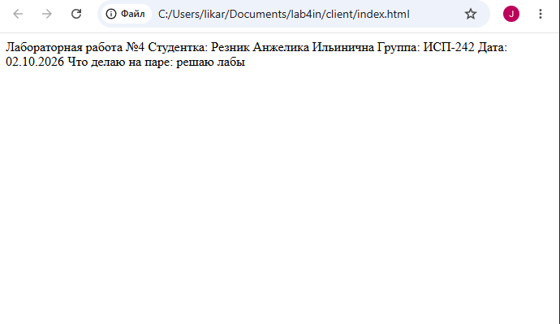
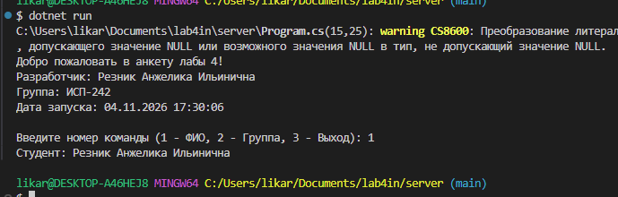
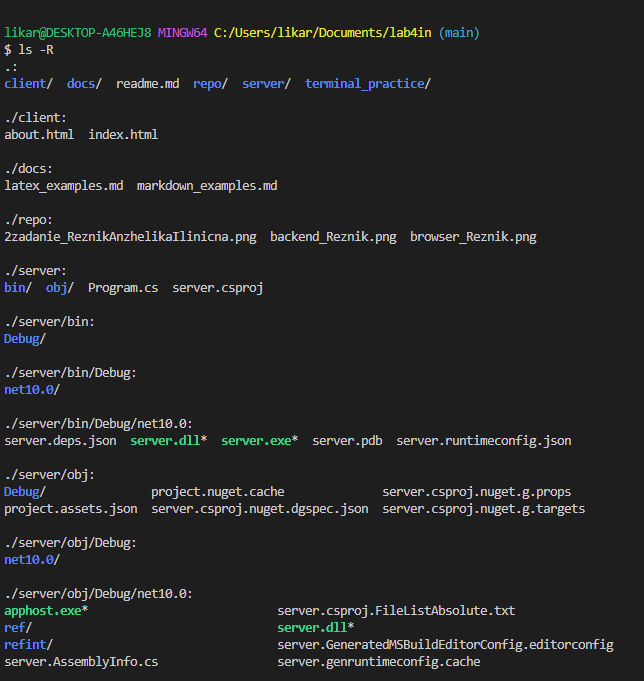
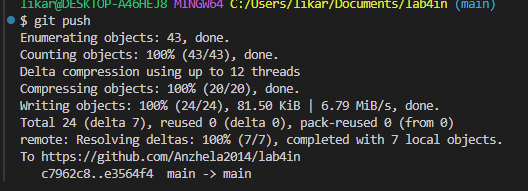

# лабораторная работа №4. работа с git и структурой проекта

**выполнила:** резник анжелика ильинична  
**группа:** исп-242  
**дата:** 04.11.2026  

## 1. описание проекта
В этой лабораторной работе я настроила структуру папок через консоль Git Bash, создала простую веб-страницу на HTML, написала консольное приложение на C# с меню выбора и оформила документацию.

## 2. содержание
1. [структура проекта](#3-структура-проекта)
2. [ссылка на репозиторий](#4-ссылка-на-репозиторий)
3. [скриншоты работы](#5-скриншоты-работы)
4. [заключение](#6-заключение)

## 3. структура проекта
* `client/` — файлы фронтенда (index.html, about.html)
* `docs/` — примеры разметки (markdown_examples.md, latex_examples.md)
* `repo/` — папка со скриншотами для отчета
* `server/` — консольный бэкенд на C#
* `terminal_practice/` — файлы для тренировки bash-команд

## 4. ссылка на репозиторий
[Мой удаленный репозиторий GitFlic](https://gitflic.ru)

## 5. скриншоты работы
* Результат открытия страницы в браузере:

* Работа бэкенд программы:

* Структура проекта в терминале:

* История всех коммитов на сервере:

## 6. заключение
Я закрепила навыки работы с основными командами Git, научилась вести историю изменений проекта, структурировать файлы репозитория и оформлять документацию.
